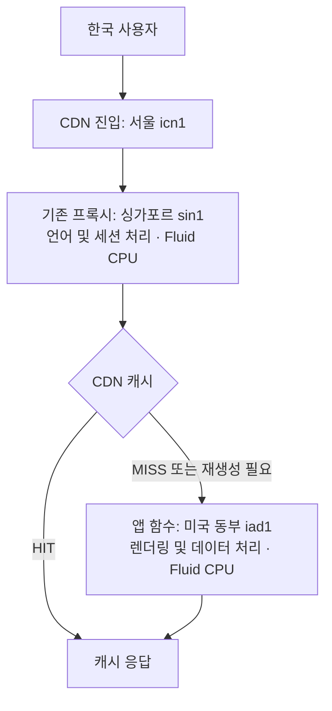
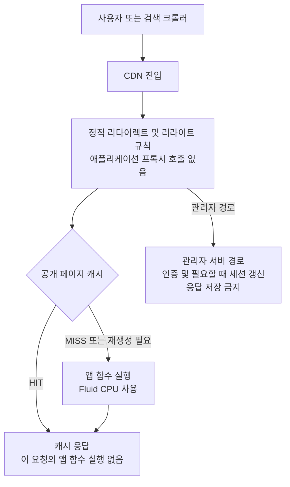

# CDN 캐시와 요청 처리 비용

## 기본 원칙

이 저장소에서는 `proxy.ts`, `middleware.ts`와 같은 Routing Middleware를 사용하지 않는다. 공개 응답은 URL로 결정하고 CDN 캐시로 제공한다. 브라우저 언어는 페이지가 표시된 뒤 클라이언트에서만 확인한다. 인증이 필요한 경로는 해당 서버 경로 안에서 검증하며 관리자 응답은 캐시하지 않는다.

Vercel의 기본 네트워크 처리, 방화벽, 정적 라우팅 규칙, 캐시 조회에도 플랫폼 CPU는 필요하다. 우리가 제거하는 것은 캐시 조회 전 실행되던 **애플리케이션 코드와 그 Fluid CPU 사용**이다. CDN 요청과 전송량 등 다른 사용량은 남는다.

## 운영에서 확인한 실행 위치

2026년 11월 1일, 기존 운영 배포 `dpl_HbWTaXTL965CQ39zypBWUdy9F1TZ`의 Vercel Metrics를 조회했다. 지역별 집계 결과이며 개별 패킷의 실제 왕복 경로를 추적한 결과는 아니다.

| 처리 | CDN 진입 지역 (`edgeNetworkRegion`) | 코드 실행 지역 (`functionRegion`) |
| --- | --- | --- |
| 기존 프록시 | 서울 `icn1` | 싱가포르 `sin1` |
| 기존 프록시 | 싱가포르 `sin1` | 싱가포르 `sin1` |
| 기존 프록시 | 포틀랜드 `pdx1` | 샌프란시스코 `sfo1` |
| 기존 프록시 | 파리 `cdg1` | 런던 `lhr1` |
| 일반 애플리케이션 함수 | 서울 등 여러 진입 지역 | 미국 동부 `iad1` |

조회 지표는 `vercel.middleware_invocation.function_cpu_time_ms`와 `vercel.function_invocation.function_cpu_time_ms`다. 프록시의 런타임은 `nodejs24.x`였다. Node.js라는 런타임 이름만으로 실행 위치를 판단할 수 없다. 가장 가까운 네트워크 PoP와 코드를 실행하는 리전도 같은 개념이 아니다. 이 운영 배포에서는 서울에서 진입한 요청의 프록시가 싱가포르에서 실행됐다. 그 배치 이유는 이 지표만으로 확인할 수 없다.

## 변경 전과 후

다음은 캐시 조회와 코드 실행의 논리적인 순서다. CDN 내부의 실제 네트워크 홉을 모두 표현하지는 않는다.

## 자주 헷갈리는 구분

- **Fluid Compute와 Active CPU**: Fluid Compute는 함수 실행 방식이고 Active CPU는 실제 코드 계산에 사용된 CPU 시간이다. 서버 렌더링과 Node.js Routing Middleware 모두 이 사용량에 포함될 수 있다. 외부 응답을 기다리는 시간 전체가 Active CPU는 아니며, 메모리 등 별도 사용량도 있다.
- **CDN과 오리진**: 캐시 적중이면 앱 렌더링을 피할 수 있다. 프록시가 있어도 그 이점은 남지만 캐시 적중 전에 프록시 비용과 지연이 생긴다. 이번 변경은 이 선행 호출을 없앤다.
- **정적 규칙**: `next.config.mjs`의 `headers`, `redirects`, `rewrites`는 빌드 시 설정으로 만들어진다. Vercel 라우팅 계층에서 캐시 조회 전에 적용될 수 있지만 요청마다 이 설정 함수를 Node.js로 실행하는 것은 아니다.
- **리다이렉트와 리라이트**: `/ko/event`는 `/event`로 308 이동한다. `/event`는 내부적으로 `/ko/event`를 제공하되 주소창은 유지한다. 언어는 요청 헤더나 쿠키로 결정하지 않는다.
- **관리자 캐시**: `Cache-Control: private, no-store`와 `CDN-Cache-Control: no-store`는 응답 헤더다. 관리자도 CDN의 네트워크·라우팅을 거칠 수 있지만 응답은 공유 캐시에 저장하지 않는다. 이 헤더는 인증을 대신하지 않는다.
- **Supabase 세션**: 공개 페이지마다 갱신할 필요가 없다. 관리자 페이지는 서버에서 실제 사용자를 검증하고, 만료가 가까우면 쿠키를 쓸 수 있는 전용 Route Handler로 이동해 갱신한다. 필요한 관리자 요청에는 추가 이동이 생기지만 공개 요청에는 영향을 주지 않는다.
- **AWS와 비교**: CloudFront 앞의 일반 Next.js 서버에서 실행되는 Proxy는 별도 엣지 배포가 없다면 그 Next.js 서버에서 실행된다. Vercel의 분산 Routing Middleware 배치와 같다고 가정하면 안 된다.

## 검색 크롤러와 남는 비용

해외 진입 지역만으로 크롤러라고 단정할 수 없다. 기존 표본에서 검색·수집 봇의 요청은 확인됐지만 전체 해외 요청의 정체는 별도 확인이 필요하다. 사람과 크롤러 모두 같은 정적 HTML과 캐시를 사용하게 하고, 지역이나 User-Agent를 검사하는 새 프록시는 추가하지 않는다.

프록시 삭제 후에도 캐시 미스와 ISR 재생성에는 CPU가 든다. 기존에는 하위 기록 데이터의 `fetch`가 1시간마다 갱신되어 공개 대회 페이지의 30일 재생성 설정을 줄였다. 후속 개선으로 기록 데이터도 30일로 맞추고 관리자 저장과 기록 업로드 시 해당 대회 태그 및 양쪽 언어 경로를 무효화한다. 관리자를 거치지 않고 Blob만 직접 덮어쓰면 최대 30일 이전 데이터가 남을 수 있으므로 게시 스크립트나 인증된 갱신 API를 반드시 함께 사용한다. 검색 수집을 막는 것과 CPU 비용을 줄이는 것은 별개의 선택이다.

## 근거

- [Vercel CDN 구조](https://vercel.com/docs/how-vercel-cdn-works)
- [Vercel PoP와 함수 리전](https://vercel.com/docs/regions)
- [분산 Node.js Routing Middleware에 대한 Vercel 운영 설명](https://vercel.com/blog/update-regarding-vercel-service-disruption-on-october-20-2025)
- [Routing Middleware](https://vercel.com/docs/routing-middleware)
- [함수 사용량과 요금](https://vercel.com/docs/functions/usage-and-pricing)
- [CDN 응답 헤더](https://vercel.com/docs/caching/cache-control-headers)
- [Next.js fetch의 재검증 주기](https://nextjs.org/docs/app/api-reference/functions/fetch)

## 크롤러 비용을 줄인 후속 개선

- 원본·정렬 기록의 서버 `fetch` 캐시를 1시간에서 30일로 맞췄다. 매시간 크롤러가 새 HTML 생성을 유발하던 만료 조건을 줄인다.
- 시간 구간 통계는 기록을 구간마다 반복 검색하지 않고 한 번 순회해 배정한다. 2만 개 합성 기록을 1·2·5분 구간으로 집계한 전체 결과가 이전 구현과 같았다. 로컬 Bun 비교에서 2분 집계는 호출당 약 14.48ms에서 1.04ms로 줄었다. 실제 운영 CPU 감소율을 보장하는 수치는 아니다.
- 관리자 변경은 해당 대회와 양쪽 언어의 홈·기록 경로, 사이트맵만 무효화한다. 대회 하나를 수정할 때 전체 공개 페이지를 지우지 않는다.
- 기록 업로드 API도 DB 저장 직후 해당 대회 캐시를 무효화한다. 게시 스크립트의 중복 전체 무효화 요청도 제거했다.
- 캐시 무효화 서버 액션은 관리자 권한을 직접 확인한다. 외부 갱신 API는 시크릿이 없으면 503, 인증이 틀리면 401로 거절한다. 운영과 프리뷰의 시크릿 설정 존재를 확인했다.
- 운영 빌드 테스트에서 데이터 원본을 바꿔도 Googlebot 요청에 기존 캐시가 유지되고, 인증된 대회 갱신 후 두 언어 모두 새 데이터를 제공함을 확인했다.

최근 지표(2026-10-31~11-01 UTC 일별 집계의 상위 그룹)에는 Googlebot, Naverbot, OpenAI SearchBot, Meta 수집 봇의 캐시 적중과 일부 미스·재생성이 함께 있었다. 봇 이름이 비어 있는 요청은 사람이라고 단정할 수 없다. 지리적 진입 위치와 봇 여부 역시 별개다.

기록 결과·지도·OG 이미지 등 동적 서버 경로에는 여전히 CPU가 들 수 있다. 이번 변경은 공개 대회 페이지의 불필요한 정기 재생성과 재생성 자체의 계산량을 줄인다. 모든 크롤러 요청의 CPU를 0으로 만들었다는 뜻은 아니다.
